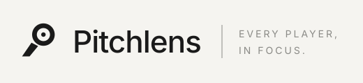
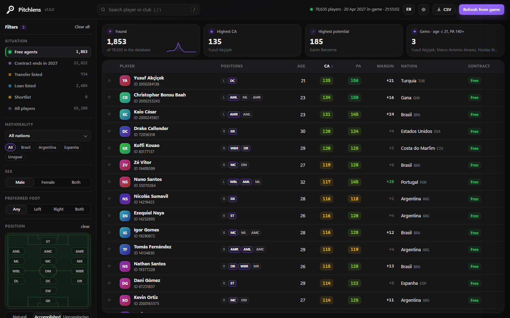
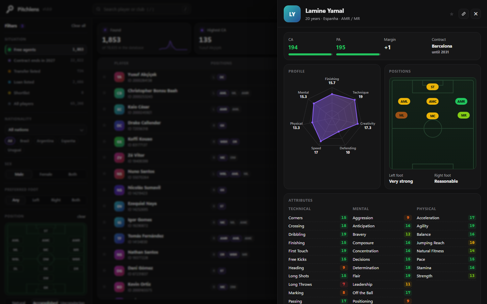
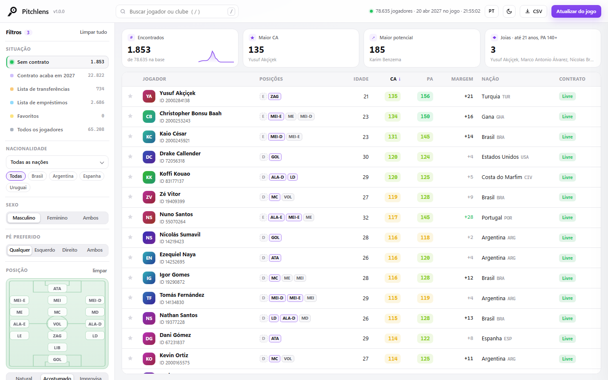

<picture>
  <source media="(prefers-color-scheme: dark)" srcset="docs/brand/pitchlens-logo-dark.svg">
  
</picture>

**Live scouting for Football Manager 27.** Search every player in your running save — free agents, transfer and loan
lists, expiring contracts, CA/PA, positions, preferred foot and full attributes — in a fast, modern web UI.

[Português](README.pt-BR.md) · [Technical notes](docs/TECHNICAL.md) · [Brand](docs/brand/README.md)

## What it is

Pitchlens is a small local tool that **reads the memory of the running game** and shows every player of your current
save in a searchable table. It is in the spirit of classic scouting tools (Genie Scout, FM Scout), built from scratch,
open source and with **zero dependencies**: just Python and your browser.

- It **only reads** the game. It never writes to `fm.exe` or to your save file.
- Everything runs on **your PC** (`127.0.0.1`). No internet, no accounts, no telemetry.
- Data is always **live**: sign a player, advance a few days, click *Refresh from game*.

## Features

| | |
|---|---|
| 🔎 **Smart filters** | Free agents, contract ending this season, transfer listed, loan listed, shortlist, nationality, sex, preferred foot |
| 📊 **Ability ranges with histograms** | CA, PA, growth margin (PA − CA) and age, each with a live distribution chart |
| ⚽ **Position picker** | Click positions on a pitch; choose *Natural*, *Accomplished* or *Unconvincing* familiarity |
| 🧾 **Player profile** | Radar of key areas, position map, preferred foot, all technical/mental/physical/goalkeeping and hidden attributes |
| ⭐ **Shortlist** | Star players and filter by them; saved in your browser |
| 📅 **In-game date** | Detected from the save, so ages and "contract ends this year" are always right |
| 🌗 **Dark & light themes** | Plus English / Português UI (auto-detected, switch any time) |
| 📤 **CSV export** | Export the filtered list to Excel / Google Sheets |
| 🔗 **Direct links** | Every player has a link (`?p=<id>`) you can share or bookmark |

## Requirements

- **Windows 10/11**
- **Football Manager 27** (tested with the Steam version, build 27.0.x)
- **Python 3.10 or newer** — get it from [python.org](https://www.python.org/downloads/) or the Microsoft Store.
  No packages to install. If Python is missing, Pitchlens tells you and opens the download page.

## Getting started

1. Download this repository (**Code → Download ZIP**) and extract the whole folder, or `git clone` it.
2. Open Football Manager 27 and **load your save**.
3. Double-click **`Pitchlens.exe`**.
4. Pitchlens opens in its own window, like any desktop app (no console, no browser).
   The first read of your save takes 15–35 seconds.
5. Click **Refresh from game** whenever you want fresh data. Closing the window closes Pitchlens.

On the first run Pitchlens also creates a **Pitchlens** shortcut on your Desktop and in the Start Menu.

> **"Windows protected your PC"?** Pitchlens.exe is small and not code-signed (its source is in
> [`launcher/`](launcher/Pitchlens.cs), and you can rebuild it with `launcher\build.bat`). Click
> **More info → Run anyway**. Windows only asks the first time.

The window uses **Microsoft Edge WebView2**, the web engine that already ships with Windows 10/11
(the `runtime/` folder holds Microsoft's small, signed WebView2 SDK files). Without it, Pitchlens opens in your
default browser instead.

Developer / terminal mode

- `py scout.py` — start the server and open it in your default browser.
- `py scout.py --no-browser --port 9000` — only start the server, on another port.
- `Pitchlens.pyw --server --port N` is what the window starts in the background (with `pythonw`, so no console).
- Logs of the desktop mode: `%LOCALAPPDATA%\Pitchlens\pitchlens.log`.

## Light theme, in Portuguese

## How it works

The game keeps every player in memory as an object of the same C++ class. Pitchlens opens the `fm.exe` process with
read-only rights, finds all those objects through their *vtable* pointer and decodes the fields it needs (name,
ability, contract, positions, attributes…). The full method and the memory map are in
**[docs/TECHNICAL.md](docs/TECHNICAL.md)**.

## FAQ

**Is it safe for my save?** Yes. The process is opened with `PROCESS_VM_READ` only, so the tool cannot change the game.

**Does it work online / with mods?** It works with any single-player save, with or without database mods.

**A game update broke it.** The app tries to rediscover the player class automatically. If fields still look wrong,
please open an issue — [docs/TECHNICAL.md](docs/TECHNICAL.md) explains how to re-map them.

**Why are a couple of attributes 1 point off?** FM stores attributes on a 1–100 scale and the screen shows 1–20;
the rounding used here may differ by one point on a few values.

**Antivirus warning?** Reading another process's memory is what memory scanners do, so some antiviruses may flag it.
The source is fully open; read it before running if you prefer.

## Contributing

Issues and pull requests are welcome: new filters, translations (`web/i18n.js`), mapping more fields
(wages, values, reputation) or support for new game builds.

## Disclaimer

Pitchlens is an unofficial fan project. It is **not affiliated with, endorsed by or connected to Sports Interactive
or SEGA**. "Football Manager" is a trademark of Sports Interactive / SEGA. Use at your own risk.

## License

[MIT](LICENSE). `runtime/` contains Microsoft WebView2 SDK files redistributed under their own BSD-style license
([runtime/WebView2-LICENSE.txt](runtime/WebView2-LICENSE.txt)).
