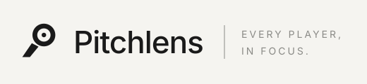
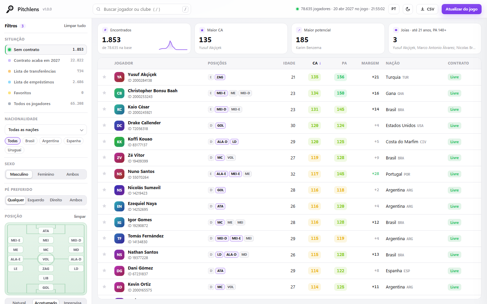
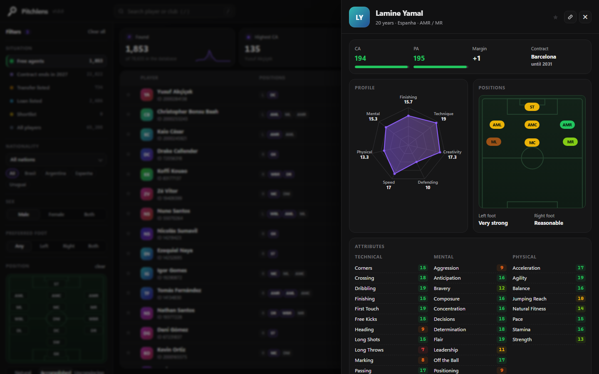
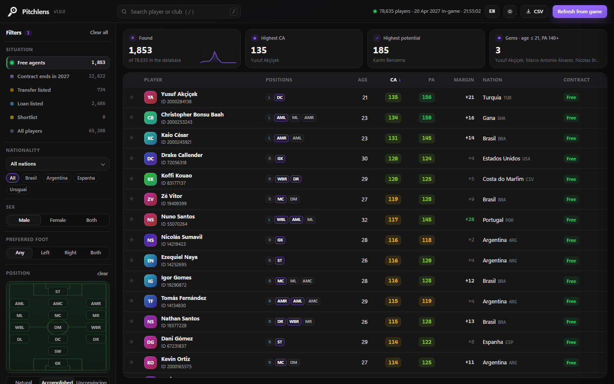

<picture>
  <source media="(prefers-color-scheme: dark)" srcset="docs/brand/pitchlens-logo-dark.svg">
  
</picture>

**Scout ao vivo para o Football Manager 27.** Pesquise todos os jogadores do seu save em andamento — sem contrato,
listas de transferência e empréstimo, contratos acabando, CA/PA, posições, pé preferido e todos os atributos — numa
interface web rápida e moderna.

[English](README.md) · [Notas técnicas (inglês)](docs/TECHNICAL.md) · [Identidade visual](docs/brand/README.md)

## O que é

O Pitchlens é uma ferramenta local que **lê a memória do jogo aberto** e mostra todos os jogadores do seu save numa
tabela com filtros. Segue a ideia dos scouts clássicos (Genie Scout, FM Scout), mas foi feito do zero, é código aberto
e **não tem dependências**: só Python e o seu navegador.

- **Só lê** o jogo. Nunca escreve no `fm.exe` nem no arquivo do save.
- Tudo roda **no seu PC** (`127.0.0.1`). Sem internet, sem conta, sem coleta de dados.
- Os dados são **ao vivo**: contrate alguém, avance uns dias e clique em *Atualizar do jogo*.

## Funcionalidades

| | |
|---|---|
| 🔎 **Filtros inteligentes** | Sem contrato, contrato acabando na temporada, lista de transferências, lista de empréstimos, favoritos, nacionalidade, sexo, pé preferido |
| 📊 **Faixas com histograma** | CA, PA, margem de evolução (PA − CA) e idade, cada uma com gráfico de distribuição ao vivo |
| ⚽ **Seletor de posições** | Clique nas posições de um campinho e escolha familiaridade *Natural*, *Acostumado* ou *Improvisa* |
| 🧾 **Ficha do jogador** | Radar das principais áreas, mapa de posições, pé preferido e todos os atributos técnicos, mentais, físicos, de goleiro e ocultos |
| ⭐ **Favoritos** | Marque jogadores com estrela e filtre por eles (fica salvo no navegador) |
| 📅 **Data do jogo** | Detectada no save, então idade e "contrato acaba neste ano" ficam sempre certos |
| 🌗 **Tema escuro e claro** | E interface em português ou inglês (detecta sozinho, troca quando quiser) |
| 📤 **Exportar CSV** | Exporte a lista filtrada para Excel / Planilhas Google |
| 🔗 **Links diretos** | Cada jogador tem um link (`?p=<id>`) para salvar ou compartilhar |

## Requisitos

- **Windows 10/11**
- **Football Manager 27** (testado na versão Steam, build 27.0.x)
- **Python 3.10 ou mais novo** — baixe em [python.org](https://www.python.org/downloads/) ou na Microsoft Store.
  Não precisa instalar nenhum pacote. Se faltar o Python, o Pitchlens avisa e abre a página de download.

## Como usar

1. Baixe este repositório (**Code → Download ZIP**) e extraia a pasta inteira, ou faça `git clone`.
2. Abra o Football Manager 27 e **carregue o seu save**.
3. Dê dois cliques em **`Pitchlens.exe`**.
4. O Pitchlens abre na própria janela, como qualquer programa (sem tela preta, sem navegador).
   A primeira leitura do save leva de 15 a 35 segundos.
5. Clique em **Atualizar do jogo** sempre que quiser os dados novos. Fechou a janela, fechou o Pitchlens.

Na primeira vez, o Pitchlens também cria um atalho **Pitchlens** na Área de Trabalho e no Menu Iniciar.

> **"O Windows protegeu o computador"?** O Pitchlens.exe é pequeno e não tem assinatura digital (o código está
> em [`launcher/`](launcher/Pitchlens.cs) e dá para recompilar com `launcher\build.bat`). Clique em
> **Mais informações → Executar assim mesmo**. O Windows só pergunta na primeira vez.

A janela usa o **Microsoft Edge WebView2**, o motor web que já vem no Windows 10/11 (a pasta `runtime/` tem os
arquivos pequenos e assinados do SDK do WebView2 da Microsoft). Sem ele, o Pitchlens abre no navegador padrão.

Modo desenvolvedor / terminal

- `py scout.py` — inicia o servidor e abre no navegador padrão.
- `py scout.py --no-browser --port 9000` — só inicia o servidor, em outra porta.
- O `Pitchlens.pyw --server --port N` é o que a janela liga por trás (com `pythonw`, por isso sem tela preta).
- Log do modo app: `%LOCALAPPDATA%\Pitchlens\pitchlens.log`.

## Tema escuro, em inglês

## Como funciona

O jogo guarda cada jogador na memória como um objeto da mesma classe C++. O Pitchlens abre o processo `fm.exe` só com
permissão de leitura, encontra todos esses objetos pelo ponteiro de *vtable* e decodifica os campos necessários (nome,
capacidade, contrato, posições, atributos…). O método completo e o mapa da memória estão em
**[docs/TECHNICAL.md](docs/TECHNICAL.md)**.

## Perguntas frequentes

**É seguro para o meu save?** Sim. O processo é aberto só com `PROCESS_VM_READ`, então a ferramenta não consegue
alterar o jogo.

**Funciona com mods?** Funciona com qualquer save single-player, com ou sem mods de banco de dados.

**Uma atualização do jogo quebrou.** O app tenta redescobrir a classe dos jogadores sozinho. Se os campos continuarem
errados, abra uma issue — o [docs/TECHNICAL.md](docs/TECHNICAL.md) explica como remapear.

**Por que um ou outro atributo difere 1 ponto?** O FM guarda os atributos numa escala de 1 a 100 e mostra de 1 a 20;
o arredondamento usado aqui pode diferir em um ponto em alguns valores.

**O antivírus reclamou?** Ler a memória de outro processo é o que scanners de memória fazem, então alguns antivírus
podem estranhar. O código é todo aberto; se preferir, leia antes de rodar.

## Contribuindo

Issues e pull requests são bem-vindos: novos filtros, traduções (`web/i18n.js`), mapear mais campos (salários,
valores, reputação) ou suporte a novas versões do jogo.

## Aviso

O Pitchlens é um projeto de fã, não oficial. **Não tem ligação, apoio ou vínculo com a Sports Interactive ou a
SEGA.** "Football Manager" é marca registrada da Sports Interactive / SEGA. Use por sua conta e risco.

## Licença

[MIT](LICENSE). A pasta `runtime/` contém arquivos do SDK do WebView2 da Microsoft, redistribuídos sob a licença
deles, estilo BSD ([runtime/WebView2-LICENSE.txt](runtime/WebView2-LICENSE.txt)).
